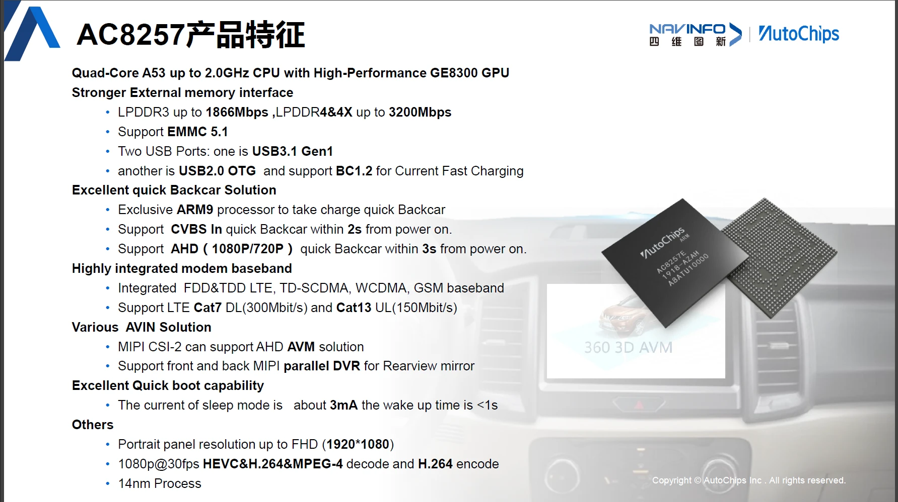

# Noyau LibreHU pour l'UJC201 (Jancar, Autochips AC8257)

Noyau Linux 4.9.117 de l'autoradio Jancar UJC201 (SoC Autochips AC8257), construit sur les **sources GPL officielles
d'Autochips** recues de SIXWIN / Jancar le 19/10/2026, auxquelles on ajoute les modifications LibreHU.

**Etat** (21/10/2026, CI run 64, `f678cd166`) : **utilisable au quotidien sur l'unite**, depuis la partition
recovery comme depuis `boot` : ROM stock jusqu'au launcher, tactile, audio, Wi-Fi, Bluetooth, FM, USB, Ethernet,
camera de recul et entrees CVBS, root, 2,4 GHz stable. Detail fonction par fonction :
[Ce qui marche](#ce-qui-marche-sur-lunite) et [docs/STATUS.md](docs/STATUS.md).

> Les modifications de `reverse-engineering` sont reprises (voir [Modifications LibreHU](#modifications-librehu)),
> plus l'overclock jusqu'a 2,6 GHz avec tensions reglables, l'Ethernet USB integre et le pilote du decodeur camera
> TP9963, absent du paquet, reconstruit depuis le noyau stock.

## Ce qui marche sur l'unite

Tests sur l'UJC201 de l'auteur (dalle Goodix GT911, decodeur camera TP9963, ROM stock Jancar Android 9), kernel
`LibreHU-main` run 64 (`f678cd166`) sauf mention. ✅ fonctionne · 🟡 fonctionne avec une reserve · ❌ ne fonctionne
pas · ⬜ pas encore teste.

| Domaine | Fonction | Etat | Detail |
|---|---|---|---|
| Demarrage | Compilation CI | ✅ | `Image.gz-dtb`, images recovery et boot (runs 64 et 65 pour les deux branches) |
| Demarrage | Demarrage depuis la partition recovery | ✅ | jusqu'au launcher de la ROM stock |
| Demarrage | Demarrage depuis `boot` | ✅ | sans artefact ni glitch |
| Demarrage | Stabilite | ✅ | 40 min d'usage sans plantage, Geekbench 5 termine |
| Stockage | eMMC, `/data` | ✅ | |
| Stockage | Ecriture sur `/system` (`adb remount`) | ✅ | corrige : le noyau ne cree plus `mmc0/sw_wp_en` (absent du stock), qui faisait refuser les ecritures (EXT4 I/O error) |
| Stockage | Etat du systeme de fichiers `/system` | 🟡 | 244 erreurs ext4 anciennes enregistrees (depuis le 13/10), aucune nouvelle ; `e2fsck -fn` (lecture seule) a faire depuis TWRP |
| Systeme | Root KernelSU Next | ✅ | `su -c id` |
| Systeme | Mise en veille / reprise | 🟡 | `stable-4.9.337` : premiere vraie veille reussie (29/10) ; reprise (dalle, tactile, USB) corrigee en `r126` / `r127`, filets de securite USB et gadget USB en `r130`, a tester ; DVD USB et son au reveil a analyser ([docs/STABLE.md](docs/STABLE.md#veille-et-reprise)) |
| Affichage | Ecran 1280 x 720, rotation | ✅ | rotation lue dans la metazone (`persist.sf.hwrotation=90`) |
| Affichage | GPU PowerVR GE8300 | ✅ | OpenGL ES 3.2, meme pilote que le stock |
| Affichage | Retro-eclairage ecran et touches | ✅ | luminosite maximale plus haute que le stock |
| Affichage | Ecran externe / second ecran | ⬜ | |
| Tactile | Dalle Goodix GT911 | ✅ | calibration Jancar `gt9xx_props` et identifiant de dalle reproduits du stock |
| Tactile | Touches virtuelles hors ecran | ✅ | apres une calibration dans LibreHU-service |
| Tactile | Autres dalles (FocalTech, ILITEK, Himax, Hynitron) | ⬜ | pilotes presents, pas de telles dalles sur l'unite de test |
| CPU / GPU | 2,3 GHz au demarrage | ✅ | |
| CPU / GPU | 2,4 GHz | ✅ | stable, Geekbench 5 |
| CPU / GPU | 2,5 GHz | ⬜ | **instable a 1,10 V** (`r127`, Geekbench, 30/10) : Vsram 50 mV sous Vproc ; a retester a 1,05 V (`r129`) |
| CPU / GPU | 2,6 GHz | ⬜ | **instable a 1,10 V** (watchdog materiel apres 14 min) ; a retester a 1,05 V (`r129`) ; au-dela, plafond de Vsram de la SSPM ([docs/TUNING.md](docs/TUNING.md)) |
| CPU / GPU | GPU 730 MHz, tensions reglables | ⬜ | |
| CPU / GPU | Sondes de temperature | 🟡 | toutes OK sauf « batterie » a 0 °C (l'unite n'a pas de batterie ; a comparer au stock) |
| CPU / GPU | Politique thermique LibreHU | ⬜ | `r129` : CPU reset 125 °C, freins 105 °C, regulation 100 °C (CTM coupe) ; carte arret 105 °C, reset 107 °C (le vendor n'en active aucun) ; [docs/TUNING.md](docs/TUNING.md) |
| Audio | Sortie audio (RCA) | ✅ | |
| Audio | Lecture sous forte charge CPU | 🟡 | quelques « data underflow » pendant Geekbench |
| Audio | Appel mains libres Bluetooth | ⬜ | |
| Connectivite | Wi-Fi client | ✅ | -59 dBm, 65 Mbit/s en 2,4 GHz |
| Connectivite | Point d'acces, Wi-Fi Direct | ✅ | |
| Connectivite | Bluetooth | ✅ | detection a distance, appairage, A2DP |
| Connectivite | Radio FM | ✅ | avec RDS |
| Connectivite | GPS | ✅ | position a ±4 m, 21 satellites utilises (GPS, GLONASS, Galileo, BeiDou) |
| Connectivite | Branche `connectivity-builtin` (pilotes integres au noyau) | ⬜ | CI verte (run 65), pas encore flashee |
| USB / reseau | adb, USB peripherique | ✅ | |
| USB / reseau | USB 1 et USB 2 en hote | ✅ | |
| USB / reseau | Ethernet USB RTL8152 | ✅ | quelques `Rx status -71` (erreur de protocole USB) |
| USB / reseau | Autres adaptateurs Ethernet (RNDIS, iPhone, AX88179...) | ⬜ | pilotes integres |
| USB / reseau | Lecteur CD / DVD USB | ⚠️ | detecte, CD audio lu par LibreHU Disc ; **panique du noyau** a la premiere erreur de lecture audio (bug du 4.9 : `rq->sense` NULL dans `cdrom_read_cdda_bpc`), corrigee (a retester) |
| Vehicule | MCU / CAN (`ttyS1`) | ✅ | MCU detecte, commandes executees |
| Vehicule | Marche arriere (GPIO 2 du SoC) | ✅ | active a l'etat bas |
| Vehicule | Sortie AMP CONT (ampli / caisson) | ✅ | commande MCU `44` |
| Vehicule | Frein a main, feux (ILL), ACC | ✅ | trames MCU `04`, `0B`, `00` |
| Vehicule | `/dev/gpios_ioctl` (Jancar) | ✅ | pilote le commutateur video CVBS |
| Vehicule | Metazone `/dev/mtz` | ✅ | lecture (rotation, format camera) |
| Vehicule | Telecommande IR | ⬜ | |
| Vehicule | spidev, UART2 / UART3 | ⬜ | |
| Video | CVBS IN 1 | ✅ | position AV (0/0) du commutateur |
| Video | CVBS IN 2 | ✅ | position 1/0 |
| Video | Camera de recul CVBS | ✅ | vue de recul LibreHU-service, 720 x 576 |
| Video | Camera de recul AHD (TP9963) | 🟡 | puce detectee (ID `0x2863`), image non testee faute de camera AHD |
| Video | Recul rapide ARM2 au demarrage | ⬜ | l'ARM2 rend bien la main a Linux (`arm2 status 2`) |
| Video | VIDEO OUT (puce USB MacroSilicon) | ⬜ | aucun pilote noyau necessaire, USB hote |
| Video | Decodeurs TP9951 / TP2855 d'autres series d'UJC201 | ❌ | reconnus par le stock, absents du paquet GPL ; sans effet sur une unite a TP9963 |

Points connus sans consequence : messages `bc_failed` du pilote `backcar` (le DT stock donne ses GPIO a
`gpios_ioctl` et au recepteur IR), avertissement `atc_alsa` en double au demarrage de l'audio, echecs `insmod` des
modules Ethernet du stock (pilotes deja integres).

## Broches et signaux du vehicule (MCU ou SoC)

Source des branchements : ivi-services de Jancar (`Platform_AutoChips_8257_Base`, doc de LibreHU-service
`docs/ivi-services/02-hardware.md`), DT stock. Numero global Linux = broche + 329 (`/sys/kernel/debug/gpio`).
✅ OK · ❌ NOK · ⬜ non teste · — sans objet sur cette unite.

| Signal | Relie a | Broche / trame | Sens | Etat | Note |
|---|---|---|---|---|---|
| Marche arriere | SoC | GPIO 2 (`gpio-331`) | entree, actif bas | ✅ | lue via `/dev/gpios_ioctl` ; aussi `backcar_sdbc_gpio` du DT (d'ou le refus `bc_failed`) |
| Marche arriere par la box CAN | MCU / CAN | broadcast `action_backcar_notification` | — | — | box Hiworld non compatible avec la Clio 3 de test ; le fil (GPIO 2) suffit |
| ACC | MCU | trame `00` | — | ✅ | la GPIO 134 existe mais Jancar prend l'ACC sur le MCU |
| Frein a main | MCU | trame `04` | — | ✅ | sens inverse si metazone 65952 = `0x5A5A5A51` |
| Feux (ILL) | MCU | trame `0B` | — | ✅ | |
| Clignotant gauche | SoC (selon ivi-services) | GPIO 7 (`gpio-336`) ; faisceau B1 « L-TURN » | entree, actif bas | — | lue `lo` au repos, inchangee avec B1 a la masse ou a +12 V (via 1 kΩ) : non cable sur cette unite |
| Clignotant droit | SoC (selon ivi-services) | GPIO 6 (`gpio-335`) ; faisceau B2 « R-TURN » | entree, actif bas | — | lue `hi` au repos, inchangee avec B2 a la masse ou a +12 V : non cable sur cette unite |
| Ecran allume / eteint | SoC | GPIO 5 (`gpio-334`) | sortie, 1 = allume | ✅ | `out hi` ; la luminosite est le PWM `lcd-backlight` |
| Mute ampli | SoC | GPIO 166 (`gpio-495`) | sortie, 1 = muet | ✅ | `out lo`, son OK |
| Commutateur video SW1 / SW2 | SoC | GPIO 167 / 165 (`gpio-496` / `gpio-494`) | sorties | ✅ | CVBS IN 1 (0/0), IN 2 (1/0), recul CVBS (1/1) OK |
| Alimentation antenne radio | SoC + MCU | GPIO 110, commande MCU `43` | sortie | ✅ | FM recue avec RDS |
| Tuner I2C (reset) | SoC | GPIO 112 | sortie | — | pas de tuner I2C (`jancar.radio.id = -1`), FM interne MT6631 |
| Reset hub USB | SoC | GPIO 174 | sortie, impulsion 0 | ⬜ | a la coupure de l'ACC |
| Inconnues | SoC | GPIO 164, 97 | sorties, 1 au demarrage | ⬜ | |
| Liaison MCU | SoC | `/dev/ttyS1`, 115200 bauds | — | ✅ | MCU detecte, commandes executees (AMP CONT) |
| AMP CONT (allumage ampli externe / caisson) | MCU | commande `44` (`44 01` / `44 00`) | sortie | ✅ | coupee a l'ACC off par ivi-services / LibreHU-service |
| Tactile GT911 | SoC | RST GPIO 45, INT GPIO 29, I2C 3 `0x5d` | — | ✅ | |
| Recepteur IR | SoC | broche 4 (`gpio-333`) | entree, IRQ | ⬜ | aussi `backcar_hdavm_gpio` du DT |
| Detection recul HD (`backcar`) | SoC | broche 1 (`gpio-330`) | entree | ⬜ | prise par le pilote `backcar` |
| Decodeur camera TP9963 | SoC | I2C `0x45`, PDN / RST | — | ✅ | repond (ID `0x2863`) |
| Processeur audio BD37534 | SoC | I2C 6 `0x40` | — | ✅ | pilote par Android, son OK |

## Le SoC AC8257



Page « AC8257产品特征 » (caracteristiques de l'AC8257) de la
[brochure AutoChips 2020](https://img.sae-china.org/resources/platform/uploadid_1612260475_QARR.pdf), © AutoChips.

Ce qu'on en verifie sur l'unite :

| Annonce | Sur l'UJC201 |
|---|---|
| 4 coeurs Cortex-A53 jusqu'a 2,0 GHz, GPU GE8300 | **oui** : 4 coeurs au demarrage (`SMP: Total of 4 processors activated`, MIDR `410fd034` = Cortex-A53), table stock a 2001 MHz maximum, PowerVR GE8300. L'overclock LibreHU (2,3 GHz au demarrage, 2,6 GHz possibles) depasse donc la fiche : voir [docs/TUNING.md](docs/TUNING.md) |
| ARM9 dedie au recul rapide (CVBS en 2 s, AHD 1080p / 720p en 3 s) | **oui** : c'est l'« ARM2 » (`dualarm`, memoire `arm2-backcar-*`) ; il rend la camera a Linux apres le demarrage |
| AHD par MIPI CSI-2 | **oui** : decodeur Techpoint TP9963 sur MIPI ; CVBS par le decodeur integre (TVD) ; voir [docs/VIDEO.md](docs/VIDEO.md) |
| LPDDR3 / LPDDR4(X), eMMC 5.1, USB 3.1 Gen1 + USB 2.0 OTG, modem LTE Cat 7 integre, ecran jusqu'a 1920 x 1080, decodage 1080p30 H.265 / H.264 | non verifie un par un ; l'ecran de l'unite est en 1280 x 720 |
| Gravure 14 nm | non verifiable ici (aucune autre source trouvee) |

C'est une fiche commerciale : elle donne les limites de la puce, pas celles de la carte Jancar (alimentation,
refroidissement, puces presentes).

## Les branches

| Branche | Contenu | Regle |
|---|---|---|
| **`LibreHU-main`** (par defaut) | `autochips-gpl` + nos modifications | **branche de travail** : tout nouveau travail sur le noyau arrive ici |
| `autochips-gpl` | paquet GPL Autochips **tel que recu** (`kernel-4.9.tgz`, SHA-256 `f0303951…d83c577`) | jamais modifiee ; un nouvel envoi de Jancar y est ajoute tel quel |
| `connectivity-builtin` | `LibreHU-main` + Wi-Fi / BT / GPS / FM integres au noyau (sources GPL MediaTek adaptees), au lieu des modules vendor | suit `LibreHU-main` par fusion ; voir [docs/CONNECTIVITY.md](docs/CONNECTIVITY.md) sur cette branche |
| `stable-4.9.*` | `LibreHU-main` + correctifs officiels linux-stable 4.9.118 -> 4.9.337, **un lot par branche** (`stable-4.9.150`, `stable-4.9.200`, `stable-4.9.225`, `stable-4.9.250`, `stable-4.9.300`, `stable-4.9.319`, `stable-4.9.337`), empilees | les 7 lots sont appliques et compiles ; lot 1 valide sur l'unite, lot 2 demarre, les autres sont a tester ; fusion dans `LibreHU-main` une fois valides ; methode, bilan et audit : [docs/STABLE.md](docs/STABLE.md) |
| `reverse-engineering` | noyau reconstruit sans les sources Autochips (base publique MediaTek MT6761 + reverse engineering) ; demarre la ROM stock | reference : on y reprend les modifications ; garde aussi les notes de l'appareil (`docs/ujc201/`) et les outils `tools/ac8257/` (usbnet, audio, dump) |

```
autochips-gpl ──(git merge autochips-gpl)──▶ LibreHU-main ◀──(reprise commit par commit)── reverse-engineering
```

- Nouvel envoi de Jancar (pilotes manquants) : ajoute sur `autochips-gpl`, puis `git merge autochips-gpl` dans
  `LibreHU-main`.
- Modification de `reverse-engineering` : adaptee aux chemins Autochips (`ac8257` au lieu de `mt6765` / `mt6761`), un
  groupe par commit, CI verte, puis test sur l'unite. Suivi dans [docs/PORTING.md](docs/PORTING.md).

## Ce que `LibreHU-main` ajoute au paquet Autochips

### Pour compiler et demarrer l'unite (detail : [docs/BUILD.md](docs/BUILD.md))
- **CI** (`.github/workflows/build.yml`) avec le compilateur du stock (AOSP clang 6.0.2 `clang-4691093` + binutils
  GCC 4.9) et les variables de `kenv.mk` du stock (`ATC_DISABLE_BATTERY_CHARGER=yes`, `ATC_FASTDISP_VERSION=2.0`) ;
  artefacts : `Image.gz-dtb`, `config`, `recovery_test_ac8257.img`, `boot_ac8257.img` et `boot_ac8257_bootmenu.img`
  (le meme noyau derriere le menu de demarrage TWRP / Android / Fastboot de l'arbre device, voir
  [docs/BUILD.md](docs/BUILD.md)) ; les memes dans la release `latest-<branche>` de chaque build, d'ou les zips TWRP de
  [LibreHU-flashablesZips](https://github.com/LibreHU/LibreHU-flashablesZips) (LibreHU Apps, onglet Zips, categorie Noyau).
- **defconfig de l'unite** `ac8257_ujc201_defconfig` = config complete du noyau stock #72, sans les options dont les
  sources manquent (overlay `UJC201_64`, une partie des tactiles d'autres ecrans), plus les ajouts ci-dessous.
- **Device tree de l'unite** `mediatek/ac8257_ujc201` = le DT du noyau stock #72, decompile (recompile, il donne le
  DTB stock octet pour octet). Le `ac8257.dts` generique d'Autochips n'a pas le noeud GPIO Jancar, le recepteur IR,
  ni `firmware/android/vbmeta`, et monte `system` alors que l'unite est en system-as-root.
- **Reparations du paquet** (fait sous Windows) : 27 liens symboliques, 3 bits d'execution.
- **Fichiers generes par le build Android d'Autochips**, absents du paquet, repris du noyau stock : memoire reservee
  et table des partitions eMMC.
- **Outils d'image** : `tools/ac8257/repack_boot.py` + gabarits stock (boot, vbmeta du recovery).

## Modifications LibreHU

Reprises de `reverse-engineering` (commits d'origine et suivi : [docs/PORTING.md](docs/PORTING.md)), ou nouvelles.
Code LibreHU dans `drivers/misc/librehu` et `drivers/misc/jancar` ; le code Autochips n'est touche que par les
points d'accroche.

| Modification | Detail | CI | Sur l'unite |
|---|---|---|---|
| Jancar `/dev/gpios_ioctl` | `CONFIG_JANCAR_GPIOS` (noms d'options du stock), reimplementation : la source Jancar manque au paquet | OK | ✅ |
| KernelSU Next v3.4.2-legacy (API 5, branche legacy 465490a2 + 165b87fa) | hooks manuels, gestionnaire KernelSU Next v3.4.2 (la v3.4.0-legacy, API 4, etait refusee par ce gestionnaire) ; 27/10 : `reset_avc_cache` remis a seqno 0 (le compteur de 165b87fa desactivait le cache AVC, demarrage de plusieurs heures) | OK | a retester |
| Boost tactile, zram lz4, I/O deadline, gouverneurs conservative et schedutil | `interactive` reste le gouverneur par defaut, comme le stock ; boost tactile **effectif depuis `r128`** (30/10, `3ccc70f3f`) : il passait par le sysboost de la PPM, que l'init vendor laisse desactive, et ne faisait rien ([docs/TUNING.md](docs/TUNING.md)) | OK | ⬜ |
| Outils de mise au point | console pstore precoce et memoire SPM / SCP hors de Linux en boot recovery (actifs) ; panique minutee, interception des redemarrages, one-shot, retour en recovery (`CONFIG_AC8257_BRINGUP_PANIC`, **desactives** depuis le 21/10/2026) | OK | ✅ |
| **Menu de demarrage** | image `boot_ac8257_bootmenu.img` : menu TWRP / Android / Fastboot de l'arbre device devant ce noyau (`tools/ac8257/bootmenu`, `bootmenu_image.py`) ; le menu s'affiche et demarre Android, **tactile absent** (21/10/2026) : le tactile `mtk-tpd` n'etait cree que ~5 s apres l'init (`CONFIG_DELAY_QUEUE_TIME=5`, file de travail de `mtk_tpd.c`), le menu ne le cherchait que 1 s ; corrige : delai a 1 s (le stock le cree vers 2,4 s) et le menu le cherche toutes les 250 ms tant qu'il est affiche | a retester | ⚠️ |
| **Overclock CPU jusqu'a 2,6 GHz**, maximum au demarrage **2,3 GHz** | 16 OPP ; tensions progressives au-dessus de 2,0 GHz (1,0375 V a 2,1 GHz), **1,05 V au plus** de 2,2 a 2,6 GHz : plafond de Vsram de la SSPM (`r129`) ; [docs/TUNING.md](docs/TUNING.md) | OK (runs 48, 61, 129) | ✅ 2,3 et 2,4 GHz ; 2,5 / 2,6 GHz instables a 1,10 V |
| **Tensions CPU reglables** | `ac8257_cpufreq.volt_uv` / `volt_offset_uv`, 0,65-1,05 V, envoyees a la SSPM ; sur la ligne de commande, appliquees au demarrage depuis `r129` | OK (runs 48, 129) | ⬜ |
| **GPU 730 MHz** et OPP intermediaires, **tensions VCORE reglables** | le GPU tourne sur VCORE (partagee avec le SoC) : `ac8257_gpufreq.vcore_uv`, 0,60-0,90 V | OK (run 48) | ⬜ |
| **Decodeur camera TP9963** (camera AHD) | pilote `tp9963_yuv` absent du paquet, **reconstruit depuis le noyau stock** (registres, metazones, reponses a la HAL camera) et recoupe avec les pilotes GPL OpenIPC et Allwinner du meme TP9963 ; [docs/VIDEO.md](docs/VIDEO.md) | OK (run 49) | 🟡 detecte, image non testee |
| **Tactiles des autres dalles** | FocalTech FT8201, ILITEK TDDI, Himax HX83102, Hynitron CST340 : pilotes GPL publics les plus proches du stock, essayes apres le GT928 (rien ne change sur une unite a GT911) ; references des dalles et ce qui manque (Synaptics, Sitronix, Jadard) : [docs/TOUCH.md](docs/TOUCH.md) | OK (run 51) | ⬜ |
| **Telecommande IR** (`rc-jancar`) | table absente du paquet, relue dans le noyau stock : table identite, codes NEC 0x001-0x2FF = touches 1-767 (Jancar fait la correspondance cote Android) ; sans elle, la telecommande ne donne rien | OK (run 53) | ⬜ |
| Tactile : pas d'inversion de l'axe X | le pilote GT928 du paquet inverse X pour une dalle annoncant X_MAX = 1080 (celle de l'unite) ; le stock ne le fait pas : desactive pour `CONFIG_JANCAR_SOLUTION` | OK (run 49) | ✅ |
| **Calibration tactile Jancar** | `/sys/devices/platform/touch/gt9xx_props` (matrice `A B C D E F Div`) et identifiant de dalle en tete de `/proc/gt9xx_config`, comme le stock : sans eux, LibreHU-service / ivi-services ne trouvent pas la calibration et le tactile est hors cadre ; [docs/TOUCH.md](docs/TOUCH.md) | OK (runs 62, 64) | ✅ |
| **Pas de TDA7729** | le paquet ajoute les controles ALSA d'un processeur audio TDA7729 absent de l'UJC201 (son processeur est un BD37534 pilote par Android) ; la HAL audio y ecrivait : panique a 6,5 s | OK (run 57) | ✅ |
| **Alimentation des decodeurs camera** comme le stock | sequences TP2850 / TP2854 relues dans l'image stock (GPIO seulement) au lieu de regulateurs absents ; pointeurs d'erreur des regulateurs traites comme absents : panique a 26 s | OK (run 59) | ✅ |
| **Pas de `mmc0/sw_wp_en`** | la protection logicielle d'Autochips rendait `/system` non inscriptible (le vendor y ecrit 1 au demarrage ; le stock n'a pas ce fichier) | OK (run 59) | ✅ |
| **Wi-Fi / BT / GPS / FM integres** (branche `connectivity-builtin`) | pilotes de connectivite GPL MediaTek (consys MT6761, gen4m) adaptes a l'AC8257, compiles dans le noyau ; les modules vendor sont refuses | OK (run 65) | ⬜ |
| **Lecteurs CD / DVD USB** | `CONFIG_BLK_DEV_SR` (lecteur optique SCSI / USB, `/dev/block/sr0`), `CONFIG_CHR_DEV_SG` (commandes brutes : CD audio, `/dev/sg*`), `CONFIG_UDF_FS` (DVD) ; ISO 9660 / Joliet deja la. Le montage (Android ne monte pas `sr0`) et la lecture des CD audio sont cote espace utilisateur (appli [LibreHU Disc](https://github.com/LibreHU/LibreHU-disc-app)) ; correction du 4.9 : tampon de sense propre a `cdrom_read_cdda_bpc` (panique a la premiere erreur de lecture audio sinon) | en cours | ⚠️ |
| **Ethernet USB integre** | RTL8152/8153, RNDIS (partage de connexion Android), iPhone, LAN78xx, SMSC, DM9601, SR9700/9800, MCS7830, CH9200, RTL8150, Pegasus, CDC EEM (en plus d'AX88179, CDC Ether, CDC NCM du stock) | OK (run 48) | ✅ RTL8152 |

Pas a reprendre :
- **tactile** : la reconstruction adaptait le `goodix.c` generique ; ici, comme le stock, `goodix.c` d'Autochips
  sonde d'abord puis abandonne, et c'est le pilote MediaTek `GT928` (`gt9xx_driver.c`, peripherique `mtk-tpd`,
  RST GPIO 45, INT GPIO 29) qui pilote la dalle Goodix **GT911** de l'unite (firmware 1060, 1080 x 600) ;
- **USB** (connexion au premier pull-up) et **IRQ d'affichage** : deja dans les pilotes Autochips ;
- **export des CRC du noyau stock** : inutile : les CRC natifs des symboles utilises par les modules vendor
  correspondent au stock, et les modules Wi-Fi, BT, GPS, FM se chargent sur l'unite.

## Roadmap

1. **Compilation** — ✅ fait (CI run 40, 20/10/2026).
2. **Premier demarrage** depuis la partition recovery — ✅ fait (run 57, 20/10/2026 ; launcher au run 64).
3. **Parite avec le stock** — en grande partie faite (21/10/2026) : modules vendor (Wi-Fi, BT, GPS, FM), metazone,
   audio, tactile, MCU, camera de recul et entrees CVBS, que la reconstruction n'avait jamais fait marcher. Reste :
   IR, veille, ARM2 au demarrage, camera AHD, VIDEO OUT.
4. **Ajouts LibreHU** — en CI depuis le 20/10/2026 ; sur l'unite : `/dev/gpios_ioctl`, KernelSU Next, overclock
   (2,4 GHz), Ethernet USB OK ; reste a tester : tensions reglables, GPU 730 MHz, gouverneurs, boost tactile (corrige en `r128`).
5. **Usage quotidien** : installation dans `boot` — ✅ testee (21/10/2026) ; reste le retrait des options de mise au
   point et les images publiees en release.

## Futurs ajouts (pistes)

- **Sources manquantes de Jancar**, redemandees le 19/10/2026 : pilotes `JANCAR_SOLUTION` / `JANCAR_GPIOS`, pilote
  LCM `jac_*`, `lowmemorykiller` (`jancar.services`, sans utilite pour LibreHU), overlay `UJC201_64`, capteur
  `tp9963` (pour comparer a la reconstruction), tactiles d'autres ecrans. A leur arrivee : `autochips-gpl` puis
  fusion ici.
- **Modules hors arbre recompiles depuis les sources** (`wmt_drv`, `bt_drv`, `gps_drv`, `fmradio_drv`,
  `wmt_chrdev_wifi`, `wlan_drv_gen4m`, `met`, `fpsgo`) : a demander a Jancar, ou a adapter depuis l'arbre GPL
  Samsung MT6765 (meme famille de puces, connectivite MT6631) ; d'ici la, les modules stock.
- **Device tree propre a l'UJC201** au lieu de l'overlay de demonstration Autochips, et pilote d'ecran tire de la
  description de la metazone.
- **Veille / reprise**, et camera de recul rapide (ARM2) des le demarrage normal.

## Compiler from scratch

Sur un PC Linux x86-64, environ 10 Go libres. Memes etapes que la CI (`.github/workflows/build.yml`, runner
Ubuntu 22.04) ; details et pieges : [docs/BUILD.md](docs/BUILD.md). Procedure **verifiee de bout en bout** (noyau
compile, `boot_ac8257.img` produit) sur **Ubuntu 24.04** et **Ubuntu 26.04** (conteneurs propres, 21/10/2026).

Deux choses manquent aux Ubuntu recents : le paquet **`python2`** (retire depuis Ubuntu 23.04) pour le generateur DTS
d'Autochips `tools/dct/DrvGen.py` et le wrapper `bin/clang` du clang AOSP, et **`libtinfo5`** (absent de 24.04 et
26.04 : `libtinfo.so.6` seulement) dont `clang-4691093` a besoin. Les etapes 1 et 2 different donc selon la version.

```bash
# 1. Paquets
# - Ubuntu 22.04 :
sudo apt install bc bison flex libssl-dev libelf-dev cpio git curl python3 python2 libtinfo5 build-essential
mkdir -p ~/ac8257-host && ln -sf /usr/bin/python2 ~/ac8257-host/python
# - Ubuntu 24.04 / 26.04 :
sudo apt install bc bison flex libssl-dev libelf-dev cpio git curl python3 build-essential

# 2. Ubuntu 24.04 / 26.04 seulement : Python 2.7.18 compile dans /opt/python2.7 (rien d'autre n'est touche),
#    et libtinfo.so.5 = lien vers libtinfo.so.6 (assez pour clang-4691093), le tout dans ~/ac8257-host
#    CFLAGS=-std=gnu11 : GCC 15 (Ubuntu 26.04) compile en C23 par defaut, ou false/true sont des mots-cles,
#    ce qui casse Python 2.7 (« cannot use keyword 'false' as enumeration constant »)
curl -fLO https://www.python.org/ftp/python/2.7.18/Python-2.7.18.tgz
tar xzf Python-2.7.18.tgz && cd Python-2.7.18
./configure --prefix=/opt/python2.7 CFLAGS="-std=gnu11" && make -j"$(nproc)" && sudo make altinstall
cd .. && mkdir -p ~/ac8257-host
ln -sf /opt/python2.7/bin/python2.7 ~/ac8257-host/python
ln -sf /opt/python2.7/bin/python2.7 ~/ac8257-host/python2
ln -sf /usr/lib/x86_64-linux-gnu/libtinfo.so.6 ~/ac8257-host/libtinfo.so.5

# 3. Sources
git clone -b LibreHU-main https://github.com/LibreHU/android_kernel_autochips_ac8257_4.9 kernel
cd kernel

# 4. Chaine de compilation du noyau stock : binutils AOSP GCC 4.9 + AOSP clang 6.0.2 (clang-4691093)
git clone --depth 1 -b lineage-17.1 https://github.com/LineageOS/android_prebuilts_gcc_linux-x86_aarch64_aarch64-linux-android-4.9 ../gcc49  # = a61b4b9, comme la CI
mkdir -p ../clang && curl -fL https://android.googlesource.com/platform/prebuilts/clang/host/linux-x86/+archive/refs/tags/android-9.0.0_r61/clang-4691093.tar.gz | tar xz -C ../clang
# ~/ac8257-host en tete : "python" = Python 2 (wrapper bin/clang), libtinfo.so.5 (24.04 / 26.04)
export PATH="$HOME/ac8257-host:$PWD/../clang/bin:$PWD/../gcc49/bin:$PATH" LD_LIBRARY_PATH="$HOME/ac8257-host"
python --version                                    # doit afficher Python 2.7
clang --version | grep 4691093                      # doit afficher clang-4691093

# 5. Configuration et build ; python=python : DrvGen.py lance avec le Python 2 du PATH (sinon "#! /usr/bin/python")
M='O=out ARCH=arm64 CROSS_COMPILE=aarch64-linux-android- CC=clang CLANG_TRIPLE=aarch64-linux-gnu-'
M="$M ATC_DISABLE_BATTERY_CHARGER=yes ATC_FASTDISP_VERSION=2.0 python=python"
make $M HOSTCC="gcc -fcommon" ac8257_ujc201_defconfig
make $M HOSTCC="gcc -fcommon" -j"$(nproc)" Image.gz-dtb

# 6. Images pour l'unite (gabarits et vbmeta du stock)
python3 tools/ac8257/repack_boot.py tools/ac8257/stock/boot_template_250718.img out/arch/arm64/boot/Image.gz-dtb \
    recovery_test_ac8257.img --vbmeta tools/ac8257/stock/recovery_stock_vbmeta_250718.bin --size 33554432 \
    --cmdline-append "init=/init log_buf_len=8M"
python3 tools/ac8257/repack_boot.py tools/ac8257/stock/boot_template_250718.img out/arch/arm64/boot/Image.gz-dtb \
    boot_ac8257.img --size 10485760
```
Resultat : `out/arch/arm64/boot/Image.gz-dtb`, `recovery_test_ac8257.img` (test depuis la partition recovery) et
`boot_ac8257.img`. Tester d'abord depuis recovery ([docs/BUILD.md](docs/BUILD.md), *Tester sur l'unite*).

## Documentation

| Document | Contenu |
|---|---|
| [docs/README.md](docs/README.md) | index |
| [docs/BUILD.md](docs/BUILD.md) | compiler (CI, en local), particularites de l'arbre Autochips, tester sur l'unite |
| [docs/STATUS.md](docs/STATUS.md) | etat par fonction sur l'unite, compare a `reverse-engineering` |
| [docs/TUNING.md](docs/TUNING.md) | frequences et tensions CPU / GPU : tables, parametres, prudence |
| [docs/TOUCH.md](docs/TOUCH.md) | dalles tactiles de l'UJC201 : references, pilotes du stock et de LibreHU, sources |
| [docs/VIDEO.md](docs/VIDEO.md) | camera AHD (TP9963), CVBS IN, VIDEO OUT, ARM2 ; reconstruction du pilote TP9963 |
| [docs/PORTING.md](docs/PORTING.md) | modifications de `reverse-engineering` : natives, a verifier, a reprendre ; suivi |
| [README_LIBREHU.md](README_LIBREHU.md) | provenance du paquet Autochips et ce qui y manque |
| `README` | README d'origine de Linux |

## Regles

- Rien n'est ecrit sous dm-verity et vbmeta n'est jamais desactive automatiquement ; si besoin, a la main :
  `fastboot --disable-verity flash vbmeta vbmeta.img`.
- Tester d'abord depuis la partition recovery, jamais directement dans `boot` : un noyau qui boucle depuis `boot` ne
  se remplace qu'avec SP Flash Tool.
- Ne pas publier ses propres partitions `nvram`, `nvdata`, `proinfo`, `persist`, `metazone`.

Licence : GPL-2.0 (noyau Linux, voir `COPYING`).

## Soutenir le projet

LibreHU est développé bénévolement, sur le temps libre, et toutes ses applis restent gratuites. Si le projet vous est
utile, vous pouvez le soutenir par un don sur [Liberapay](https://liberapay.com/DokT/donate) (association française à
but non lucratif, dons récurrents) :

[](https://liberapay.com/DokT/donate)
[](https://liberapay.com/DokT/)
